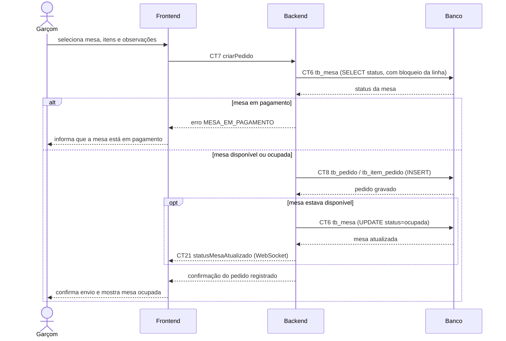

# Fluxo do E3: Lançamento de pedido pelo garçom

**Feito quando:** Garçom escolhe mesa, adiciona itens com observação e registra o pedido na mesa. Mesas em pagamento no caixa não aceitam novos lançamentos.

## Passos

1. O Garçom seleciona uma mesa (disponível ou já ocupada), escolhe os produtos no cardápio e adiciona observações. Mesas em pagamento aparecem bloqueadas na tela, por meio do contrato `statusMesaAtualizado` (CT21), e não podem ser usadas para lançar itens.
2. O Frontend envia a requisição de criação do pedido para o Backend via contrato `criarPedido` (CT7).
3. O Backend consulta o status da mesa na tabela `tb_mesa` (CT6), dentro de uma transação com controle de concorrência. Se a mesa estiver em pagamento, o Backend recusa o pedido com o erro `MESA_EM_PAGAMENTO` e o fluxo segue em "Fluxo alternativo".
4. O Backend registra o pedido na tabela `tb_pedido` e seus itens em `tb_item_pedido` (CT8).
5. Se a mesa estava disponível, o Backend atualiza o status para "Ocupada" na tabela `tb_mesa` (CT6) e publica o evento `statusMesaAtualizado` (CT21) para os painéis do Garçom e do Caixa.
6. O Backend retorna ao Frontend a confirmação do pedido registrado com o valor total atualizado.
7. O Frontend exibe ao Garçom a confirmação do envio do pedido e atualiza a cor da mesa.

## Fluxo alternativo: mesa em pagamento

1. O Backend responde ao Frontend com o erro `MESA_EM_PAGAMENTO` e nenhum dado é gravado.
2. O Frontend informa ao Garçom que a mesa está em pagamento no caixa e que o lançamento só é possível se o pagamento for cancelado.

Esse caso acontece quando a tela do Garçom está desatualizada ou desconectada, ou quando o caixa inicia o pagamento no mesmo instante do envio do pedido.

## Diagrama de Sequência

