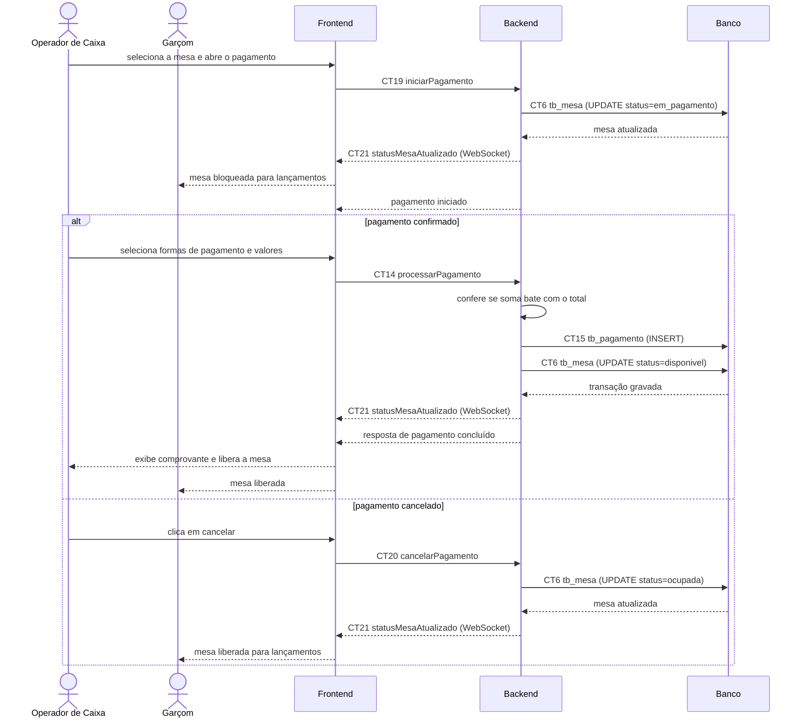

# Fluxo do E7: Divisão de pagamento (split payment)

**Feito quando:** Caixa fecha conta dividindo entre mais de uma forma de pagamento conferindo o total. Durante todo o pagamento, a mesa fica bloqueada para novos lançamentos.

## Passos

1. O Operador do Caixa seleciona uma mesa ocupada e abre a tela de pagamento.
2. O Frontend chama o Backend com o contrato `iniciarPagamento` (CT19).
3. O Backend verifica se a mesa está ocupada e sem pagamento aberto por outro operador, altera o status para "em_pagamento" na tabela `tb_mesa` (CT6) registrando o operador responsável e publica o evento `statusMesaAtualizado` (CT21).
4. Os painéis do Garçom e do Caixa recebem o evento e passam a exibir a mesa como em pagamento. A partir daí, novos lançamentos nessa mesa são recusados (E3).
5. O Operador do Caixa insere os pagamentos fracionados (ex.: parte no PIX e parte no Cartão de Crédito).
6. O Frontend calcula os totais parciais e envia a requisição de pagamento ao Backend via contrato `processarPagamento` (CT14).
7. O Backend confirma que a mesa está em pagamento e valida se a soma dos pagamentos fracionados cobre o valor total devido da mesa.
8. O Backend insere as movimentações de pagamento na tabela `tb_pagamento` (CT15) e atualiza o pedido para "Pago".
9. O Backend altera o status da mesa para "disponivel" na tabela `tb_mesa` (CT6) e publica o evento `statusMesaAtualizado` (CT21).
10. O Backend retorna a confirmação da transação e o valor do troco (se houver).
11. O Frontend exibe a confirmação do pagamento e libera a mesa na interface visual do caixa.

## Fluxos alternativos

**Cancelamento do pagamento**

1. O Operador do Caixa clica em "Cancelar" na tela de pagamento.
2. O Frontend chama o Backend com o contrato `cancelarPagamento` (CT20).
3. O Backend devolve a mesa para "ocupada" e publica o evento `statusMesaAtualizado` (CT21). O garçom volta a poder lançar itens.

**Valor insuficiente**

1. O Backend responde ao `processarPagamento` (CT14) com o erro `VALOR_PAGAMENTO_INSUFICIENTE`.
2. A mesa continua em pagamento e o Operador do Caixa pode completar os valores ou cancelar.

**Mesa já em pagamento por outro operador**

1. O Backend responde ao `iniciarPagamento` (CT19) com o erro `MESA_JA_EM_PAGAMENTO`.
2. O Frontend informa ao Operador do Caixa que a mesa já está sendo paga em outro caixa.

**Queda do caixa durante o pagamento**

1. A sessão WebSocket do operador que iniciou o pagamento cai e não volta em até 60 segundos.
2. O Backend devolve a mesa para "ocupada" e publica o evento `statusMesaAtualizado` (CT21). O Administrador também pode liberar a mesa pelo `cancelarPagamento` (CT20).

## Diagrama de Sequência

